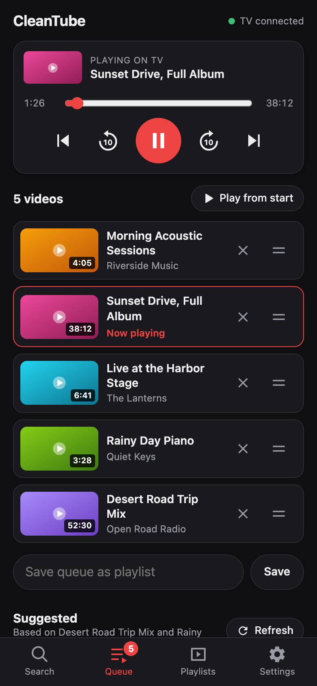

# CleanTube

An ad-free YouTube app for Android TV, Google TV and Fire TV.

## Why CleanTube

- **Tiny.** The APK is under 70 KB.
- **Three permissions.** Internet, the microphone for voice search, and installing its own updates.
- **No tracking.** No analytics and no third-party libraries. It only connects to YouTube, Google, and GitHub for updates.

## What it does

- Removes video ads and ad tiles in the feeds.
- Plays up to 4K and 60fps.
- Switches the TV's refresh rate to match the video, when the TV supports it.
- Voice search with the remote's microphone.
- Phone remote: search, queue and playlists from your phone's browser.

## Phone remote

Open the address shown in the TV's corner, such as `192.168.1.20:8080`, in your phone's browser. The phone and TV must be on the same Wi-Fi.



- Search YouTube and queue videos. The TV plays them in order.
- Reorder, pause, seek, and save the queue as a playlist.
- Get suggestions based on the queue.

No app or login needed. Anyone on your Wi-Fi can use it. Playlists are saved on the TV.

## Supported devices

| Device | Works |
|---|---|
| Android TV and Google TV, Android 7 or newer | Yes |
| Fire TV on Fire OS: Fire TV Stick 4K, 4K Max, Fire TV Cube, Fire TV smart TVs | Yes |
| Fire TV on Vega OS: Fire TV Stick 4K Select, Fire TV Stick HD 2026 | No, it can't install apps from outside the Amazon Appstore |

## Install

Download link for the newest version:

```
https://github.com/nirajrajgor/cleantube/releases/latest/download/CleanTube.apk
```

### First, turn on developer options

Every method needs this.

- **Fire TV.** Settings > My Fire TV > About, then press the device name 7 times.
- **Android TV and Google TV.** Settings > System > About, then press "Android TV OS build" 7 times.

Then pick one way to install.

### Install manually

1. Install the **Downloader** app. It's on the Amazon Appstore and Google Play.
2. Allow Downloader to install apps:
   - **Fire TV.** Settings > My Fire TV > Developer options > Install unknown apps, then turn on Downloader.
   - **Android TV and Google TV.** Settings > Apps > Security & restrictions > Unknown sources, then turn on Downloader.
3. Open Downloader, type the download link above and press Install.

### Install from an Android phone

1. Install the **Send Files to TV** app on the phone and on the TV.
2. Download the APK on the phone, then send it to the TV with the app.
3. On the TV, allow Send Files to TV to install apps, the same way as for Downloader above.
4. Open the received APK and press Install.

On Fire TV, the **Easy Fire Tools** phone app can send and install the APK in one step. It needs ADB debugging turned on, as in step 1 of the next section.

### Install with an AI agent

An AI coding agent such as Claude Code or Codex can do the install from your computer. The computer and TV must be on the same Wi-Fi.

1. On the TV, turn on debugging in Developer options:
   - **Fire TV.** Turn on ADB debugging.
   - **Android TV and Google TV.** Turn on USB debugging, and Wireless debugging if it's listed.
2. Paste this prompt into the agent:

   ```
   Find my TV on the Wi-Fi with adb and install
   https://github.com/nirajrajgor/cleantube/releases/latest/download/CleanTube.apk, then open it
   ```

3. When the TV asks "Allow USB debugging?", press Allow.
4. When it's done, turn debugging off again. The app doesn't need it.

The agent finds the TV, installs the app and opens it. If it can't find the TV, it will ask for the TV's IP address, which is in the TV's network settings.

### Updating

When a new version is out, CleanTube shows Android's install prompt when it opens. Press Install, then open CleanTube again. The phone remote's Settings tab can also check and install.

The first time, Android asks once to allow installs from CleanTube. Turn it on, press Back, then press Install.

Version 1.0 can't update itself. Install the newest version over it. Your settings are kept.

## Known limitations

- **Limited testing.** Tested on Google TV so far. [Open an issue](https://github.com/nirajrajgor/cleantube/issues) if your TV behaves differently.
- **24fps judder.** Most films are 24fps. If the TV has no 24Hz mode, slow camera pans can look slightly jerky. The TV's motion smoothing setting can hide this.
- **No HDR.** HDR videos play in SDR, because HDR streams stutter in the web view.
- **Lower quality on weak TVs.** Auto quality skips 4K at 60fps and 1440p at 60fps, because many TVs drop frames on them. You can still pick them manually.
- **Breakage.** A YouTube change can bring ads back or break playback until the app is updated.
- **Account risk.** If you sign in, Google could flag your account for using a modified client. Watching without signing in carries no account risk.

## Build from source

Ask an AI agent to "build the APK with build.sh". It sets up the tools and creates your own signing key.

## Credits

- Ad removal follows the `json-prune` rule from [uBlock Origin](https://github.com/gorhill/uBlock).
- Marking playback as ad-free comes from [TizenTube](https://github.com/reisxd/TizenTube).
- The TV user agent comes from [VacuumTube](https://github.com/shy1132/VacuumTube).

## License

[MIT](LICENSE)
